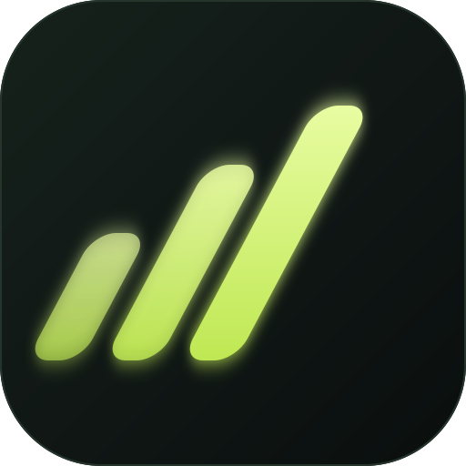
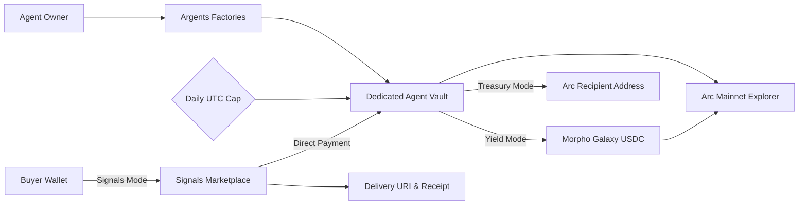

<div align="center">



<h1>Argents</h1>

<h3>Owner-controlled USDC agents you can deploy, fund, and govern on Arc.</h3>

<p>Automate Morpho yield, sell paid research reports, and manage daily treasury operations with transparent on-chain guardrails.</p>

<a href="https://argents.vercel.app"></a>
<a href="https://explorer.arc.io"></a>
<a href="https://explorer.arc.io/address/0x8E357432CC12ff425c36432F312968aEb16112AF"></a>
<a href="https://dorahacks.io/hackathon/arc-microgrants/detail"></a>
<a href="https://github.com/Datwebguy/argents"></a>

</div>

---

## The idea

Autonomous AI agents and financial automations often run into two extremes: either they operate as opaque black boxes holding raw private keys without safety limits, or they burden users with cross-token bridging and complex gas mechanics.

**Argents connects capital and agent intent on Arc.** On Arc, USDC is both the native currency and the gas asset, enabling zero-friction, single-token operations. Every agent deployed on Argents is an isolated, owner-controlled on-chain smart vault protected by a strict daily spending limit. Whether putting idle treasury funds to work on Morpho, accepting direct payments for intelligence reports, or executing team disbursements, capital deployment requires explicit owner approval while staying bound by programmable guardrails.

### Built for

| Capital Allocator | Research Analyst & Publisher | DAO & Team Treasury |
| :--- | :--- | :--- |
| Deploy idle USDC into Morpho Galaxy USDC, track positions in real time, and withdraw under daily spending caps. | Publish priced report offers, receive direct USDC payments into an agent vault, and record on-chain receipts. | Allocate operating capital, manage recipient payouts, and receive direct Arc transfers under daily spending caps. |

## Explore the product

| Area | What happens there |
| :--- | :--- |
| [**Yield Autopilot**](https://argents.vercel.app/#yield) | Select a Morpho Galaxy USDC allocation once. Every later deposit automatically restores that allocation; anyone may call maintenance, but only the owner can withdraw under the daily cap. |
| [**Signals Marketplace**](https://argents.vercel.app/#signals) | Browse paid intelligence reports, purchase access via direct USDC transfers, deliver access URIs, and confirm buyer receipt on-chain. |
| [**Treasury Mode**](https://argents.vercel.app/#treasury) | Receive native USDC deposits and send funds to designated Arc addresses, strictly bounded by a daily UTC withdrawal limit. |
| [**Discovery & Leaderboards**](https://argents.vercel.app/#discovery) | Scan Arc factory events to discover public Yield, Signals, and Treasury agents, ranked live by vault balance and total value. |

### An agent action, from intent to proof

1. **Deploy a dedicated vault.** The factory deploys an isolated, owner-controlled smart contract with a daily spending cap.
2. **Fund the agent.** Approve and deposit native USDC into the vault on Arc Mainnet.
3. **Set the operating rule.** Yield Autopilot applies its selected Morpho allocation whenever it receives a deposit; Signals and Treasury follow their respective owner-approved flows.
4. **Enforce on-chain guardrails.** The contract automatically checks the daily UTC withdrawal cap before any funds leave the vault.
5. **Inspect the verified result.** Track state changes, event logs, and balances directly through Arc Explorer.

**On-chain verification on Arc Mainnet:**
- [Yield deposit (0.02 USDC) on Arc](https://explorer.arc.io/tx/0x09d8e3406eed8dc386f046ea296d9a0d6e7205ba9bf90b3b89aac5df48804afe)
- [Morpho Galaxy USDC strategy deployment (0.01 USDC) on Arc](https://explorer.arc.io/tx/0x156f849e41303a4b4bcfc7d2508fda760cddb9e0fdc031d550fa6d01a802fb1f)
- [Vault withdrawal (0.01 USDC) recalling liquidity on Arc](https://explorer.arc.io/tx/0x375d3d3c864d662faa4fdb207db4c68fead373138756df56a2e5fd5218b53ac9)
- [Signals offer publication (ID #1) on Arc](https://explorer.arc.io/tx/0x390aae3efcb76d8705b4d8129d9f2ed303861b534c62d798bce2f502e58c6e3c)

## Agents, guardrails, and execution

Every agent on Argents is an on-chain smart vault deployed via verified factory contracts. The vault owns its assets directly, eliminating custodial third parties. In Yield mode, the vault holds ERC-4626 shares of Morpho Galaxy USDC; in Signals mode, the marketplace routes payments directly into the publisher's vault; and in Treasury mode, payouts are constrained by UTC-day expenditure quotas.



## Secure the agent flow

Most "AI agent" apps today are little more than LLM prompts wired directly to hot wallets. If an agent hallucinates, catches a prompt injection, or hits an edge case, an entire treasury can be drained in a single transaction block.

Argents enforces financial safety in **smart contracts**, not just system prompts:

- **Agents as Operators, Humans as Owners**: An agent must never hold master keys. It operates within an isolated, owner-controlled smart vault (`ArgentsYieldVault`, `ArgentsAgentVault`) where key administrative powers (spending limits, emergency recovery) are strictly gated to the human owner (`onlyOwner`).
- **Mathematically Enforced Daily Spend Limits**: Never grant infinite token allowance. Outflows are capped by on-chain daily spend limits (`spentByDay[currentDay]`) that reset automatically at midnight UTC. If an agent goes rogue, maximum 24-hour downside is strictly bounded.
- **Strict Integer Base-Unit Math**: In Web3, everything is integer base units (6 decimals for native Arc USDC: `1.00 USDC = 1,000,000` base units). Zero floating-point math, preventing rounding errors and dust drains.
- **Strict Separation of Idle vs. Deployed Capital**: Vaults maintain deterministic on-chain accounting: liquid idle USDC vs. strategy vault shares (held in Morpho Galaxy USDC). Liquidity recall and redemption are mathematically deterministic.
- **On-Chain Event Ledger as Sole Source of Truth**: Never rely on mutable off-chain databases. Every deposit, allocation, share recall, and transfer is an immutable EVM log on Arc.
- **Trust-Minimized Content & Signal Settlement**: In Signals mode (`ArgentsSignals.sol`), payments, access URIs, and buyer receipts are anchored directly on Arc.
- **Zero API Keys in Client Builds**: Argents runs with zero backend API keys and zero private environment variables. All reads use public Arc RPC nodes (`https://rpc.mainnet.arc.io`), and all mutations are signed directly by user wallets.

### Automated stress tests: breaking the boundaries

Before deployment, automated test suites actively challenged and verified each on-chain boundary:

```text
[TEST 01] Single-transaction limit breach: withdraw > daily cap      -> REVERTS (ExceedsDailyLimit)
[TEST 02] Cumulative daily drain: 10 valid transfers + 1 excess      -> REVERTS on #11 (Resets 00:00 UTC)
[TEST 03] Unauthorized caller execution: non-owner withdrawal        -> REVERTS (OwnableUnauthorized)
[TEST 04] DeFi liquidity stress: Morpho Galaxy partial redemption    -> DETERMINISTIC SHARE RECALL
[TEST 05] Boundary fuzzing: 0.000001 USDC micro-dust, zero, negative -> VALIDATED BASE UNITS
[TEST 06] Network concurrency & RPC latency simulations              -> ZERO DOUBLE-SPEND
[TEST 07] Asset reconciliation: totalAssets() == idle + Morpho       -> 100% RECONCILED ON ARC MAINNET
```

> **The Golden Rule:** Don't ask: *"Is my autonomous agent safe?"* Ask: **"What is the maximum mathematical loss this agent can cause in 24 hours if the AI completely loses its mind?"** If the answer isn't a hard number enforced by a smart contract, you aren't ready for mainnet.

## How the pieces fit

| Layer | Technology | Role in Argents |
| :--- | :--- | :--- |
| Network | **Arc Mainnet (Chain ID 5042)** | Native USDC transfers, transaction gas fees, and immutable execution proof. |
| Yield Strategy | **Morpho Galaxy USDC** | Direct ERC-4626 vault shares held directly by the agent vault (`0x8E357432CC12ff425c36432F312968aEb16112AF`). |
| Core Factories | **Solidity 0.8.24 (`ArgentsAutopilotYield`, `ArgentsModes`)** | Deploys isolated vaults, tracks agent ownership, applies Yield allocation rules, and enforces daily withdrawal limits. |
| Paid Services & Output | **`ArgentsSignals` Marketplace** | Manages offer listings, direct buyer-to-vault payments, and on-chain delivery hashes (`0xa7C755ab5aa2a17062Dc6D45ea8594Ff43ac9A68`). |
| Safety Guardrails | **Time-bucketed Daily Caps** | Enforces maximum daily capital outflow resets every UTC midnight. |
| Web3 & UI | **HTML5, Modern CSS, Ethers v6 UMD** | High-performance, zero-build-step client reading live RPC state and caching event logs. |
| Hosting & Edge | **Vercel / OpenAI Sites** | Production static hosting with strict security headers ([argents.vercel.app](https://argents.vercel.app)). |

## Live deployments

| Purpose | Address / Link | Network |
| :--- | :--- | :--- |
| **Live Web App** | [argents.vercel.app](https://argents.vercel.app) | Production |
| **Arc Mainnet** | Chain ID `5042` · RPC `https://rpc.mainnet.arc.io` | Mainnet |
| **Native USDC (Gas Token)** | [`0x3600000000000000000000000000000000000000`](https://explorer.arc.io/address/0x3600000000000000000000000000000000000000) | Arc Mainnet |
| **Yield Factory** | [`0x02B78468aDA29F698eB6E488EB28d757aA671b6E`](https://explorer.arc.io/address/0x02B78468aDA29F698eB6E488EB28d757aA671b6E) | Arc Mainnet |
| **Yield Autopilot Factory** | [`0x30c017818F938180b2a6d8592Bd180F51EBdBbE2`](https://explorer.arc.io/address/0x30c017818F938180b2a6d8592Bd180F51EBdBbE2) | Arc Mainnet |
| **Morpho Galaxy USDC** | [`0x8E357432CC12ff425c36432F312968aEb16112AF`](https://explorer.arc.io/address/0x8E357432CC12ff425c36432F312968aEb16112AF) | Arc Mainnet |
| **Mode Factory** | [`0x1A9555E261E39830317461a767f8D7B5fBF01c5d`](https://explorer.arc.io/address/0x1A9555E261E39830317461a767f8D7B5fBF01c5d) | Arc Mainnet |
| **Signals Marketplace** | [`0xa7C755ab5aa2a17062Dc6D45ea8594Ff43ac9A68`](https://explorer.arc.io/address/0xa7C755ab5aa2a17062Dc6D45ea8594Ff43ac9A68) | Arc Mainnet |
| **Demonstration Yield Vault** | [`0x9eac69A950a13B40BE06547bE833Df653FE32Db8`](https://explorer.arc.io/address/0x9eac69A950a13B40BE06547bE833Df653FE32Db8) | Arc Mainnet |
| **Demonstration Signals Vault** | [`0x70baA8a0c215D9DbD05A340CA89E2129649ca04e`](https://explorer.arc.io/address/0x70baA8a0c215D9DbD05A340CA89E2129649ca04e) | Arc Mainnet |
| **Demonstration Treasury Vault** | [`0xcAbD3D35448E768e591210eEE216b672C8Ed19f3`](https://explorer.arc.io/address/0xcAbD3D35448E768e591210eEE216b672C8Ed19f3) | Arc Mainnet |

*Full machine-readable deployment transaction records: [deployments.arc-mainnet.json](deployments.arc-mainnet.json)*

## Run it locally

Argents runs as a static web application with compiled contract artifacts. Serve the repository root over HTTP:

```bash
# Clone the repository
git clone https://github.com/Datwebguy/argents.git
cd argents

# Serve locally using Python or Node.js
python -m http.server 4173
# or
npx serve .
```

Open `http://localhost:4173` in your browser with an EVM wallet (e.g. MetaMask, Rabby) configured for Arc Mainnet:

| Parameter | Value |
| :--- | :--- |
| **Network Name** | Arc Mainnet |
| **RPC URL** | `https://rpc.mainnet.arc.io` |
| **Chain ID** | `5042` (`0x13b2`) |
| **Currency Symbol** | `USDC` |
| **Block Explorer** | `https://explorer.arc.io` |

Arc uses native USDC for gas fees, so ensure your wallet holds a small amount of Arc USDC to cover transaction execution.

## Repository guide

| Path | Purpose |
| :--- | :--- |
| `index.html` | Single-page application shell, navigation, and modal dialogs. |
| `app.js` | Web3 wallet connection, contract interaction, and RPC log indexing. |
| `styles.css` | Design system, dark terminal aesthetics, keyframe animations, and responsive layout. |
| `favicon.svg` | Vector brand mark and favicon. |
| `package.json` | Project scripts and metadata. |
| `vercel.json` | Edge deployment routing and security headers. |
| `contracts/ArgentsYield.sol` | Yield V2 agent vault and factory interfacing with Morpho Galaxy USDC. |
| `contracts/ArgentsModes.sol` | Multi-mode agent factory for Signals and Treasury agents. |
| `contracts/ArgentsSignals.sol` | Signals marketplace for offer listings, payments, and receipts. |
| `contracts/ArgentsAgent.sol` | Base capped USDC vault contract. |
| `contracts/ArgentsAutopilotYield.sol` | Rules-based Yield vault and factory deployed on Arc Mainnet. |
| `scripts/agent-runner.cjs` | Autonomous operator runtime for inspecting agents and fulfilling signals. |
| `deployments.arc-mainnet.json` | Complete machine-readable deployment transaction logs. |
| `LICENSE` | Standard open-source MIT license. |

---

<div align="center">

<p><strong>One stablecoin. One agent economy. Built on Arc.</strong></p>

<p><a href="https://argents.vercel.app">Open Argents</a> · <a href="https://github.com/Datwebguy/argents">Explore the source</a> · <a href="https://dorahacks.io/hackathon/arc-microgrants/detail">Arc Microgrants Hackathon</a></p>

</div>
