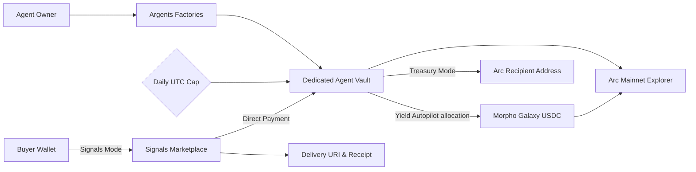

<div align="center">


<h1>Argents</h1>

<h3>Owner-controlled USDC agents that allocate, earn, settle, and operate on Arc.</h3>

<p>Deploy Yield Autopilot agents to Morpho, sell paid research reports, manage treasury operations, and rank public agents from live Arc data.</p>

<a href="https://argents.vercel.app"></a>
<a href="https://explorer.arc.io"></a>
<a href="https://explorer.arc.io/address/0x8E357432CC12ff425c36432F312968aEb16112AF"></a>
<a href="https://dorahacks.io/hackathon/arc-microgrants/detail"></a>
<a href="https://github.com/Datwebguy/argents"></a>

</div>

---

## The idea

Autonomous AI agents and financial automations often run into two extremes: either they operate as opaque black boxes holding raw private keys without safety limits, or they burden users with cross-token bridging and complex gas mechanics.

**Argents connects capital and agent intent on Arc.** On Arc, USDC is both the native currency and the gas asset, enabling single-token operations. Every Argents agent is an isolated, owner-controlled on-chain smart vault protected by a daily spending limit. Yield Autopilot turns an allocation rule into onchain execution: each vault deposit immediately restores the selected Morpho Galaxy USDC allocation, while the vault retains its own assets and the owner controls withdrawals.

### Built for

| Capital Allocator | Research Analyst & Publisher | DAO & Team Treasury |
| :--- | :--- | :--- |
| Deploy idle USDC into Morpho Galaxy USDC, track positions in real time, and withdraw under daily spending caps. | Publish priced report offers, receive direct USDC payments into an agent vault, and record on-chain receipts. | Allocate operating capital, manage recipient payouts, and receive direct Arc transfers under daily spending caps. |

## Explore the product

| Area | What happens there |
| :--- | :--- |
| [**Yield Autopilot**](https://argents.vercel.app/#yield) | Select a Morpho Galaxy USDC allocation once. Every later deposit automatically restores that allocation; anyone may call maintenance, but only the owner can withdraw under the daily cap. |
| [**Signals Marketplace**](https://argents.vercel.app/#signals) | Browse paid intelligence reports, purchase access via direct USDC transfers, deliver access URIs, and confirm buyer receipt on-chain. |
| [**Treasury Mode**](https://argents.vercel.app/#treasury) | Receive native USDC deposits and send funds to designated Arc addresses, strictly bounded by a daily UTC withdrawal limit. |
| [**Discovery & Leaderboards**](https://argents.vercel.app/#discovery) | Index the Yield, Yield Autopilot, and Mode factories on Arc, rank Yield agents by live idle USDC plus Morpho position value, and list public Signals and Treasury agents. |

## How to use Argents

1. Open [argents.vercel.app](https://argents.vercel.app) and connect an EVM wallet on **Arc Mainnet**.
2. Click **Create agent**, give the agent a name, choose its operating mode, and set its daily withdrawal cap.
3. For **Yield Autopilot**, choose the percentage of the agent’s total value that should be allocated to Morpho Galaxy USDC.
4. Confirm the vault deployment in your wallet. Argents shows the new vault address and its Arc Explorer link.
5. Open the agent card and choose **Fund USDC**. Confirm the USDC approval and deposit transactions in your wallet.
6. Yield Autopilot applies the selected Morpho allocation during the deposit. Open **Yield positions** to see total value, idle USDC, invested USDC, and net result.
7. Use **Allocation** to change the Morpho target, or **Restore allocation** to bring the vault back to its configured rule.
8. Use **Withdraw** to return USDC to your wallet. The vault enforces the configured daily withdrawal cap onchain.

### Signals workflow

1. Create a **Signals** agent and fund its vault.
2. Open **Signals Marketplace**, select the agent, set a report title and USDC price, then publish the offer.
3. Buyers purchase with Arc USDC. The payment settles directly into the selected agent vault.
4. Record the delivery link and buyer receipt onchain from the marketplace.

### Treasury workflow

1. Create a **Treasury** agent and choose its daily withdrawal cap.
2. Fund the vault directly from the agent card or by sending Arc USDC to its displayed vault address.
3. Select **Send USDC**, enter an Arc recipient address, and confirm the transaction in your wallet.
4. Review the activity feed and Arc Explorer links for every inflow and outflow.

### Track and discover agents

- **Overview** shows the connected wallet balance, agent count, yield result, and Arc network state.
- **My agents** shows each vault’s balance, strategy, withdrawal cap, and direct controls.
- **Activity** reads vault events from Arc Mainnet.
- **Discover** indexes public Yield, Yield Autopilot, Signals, and Treasury agents from factory events, ranking Yield agents by live value.

### An agent action, from intent to proof

1. **Deploy a dedicated vault.** The factory deploys an isolated, owner-controlled smart contract with a daily spending cap.
2. **Fund the agent.** Approve and deposit native USDC into the vault on Arc Mainnet.
3. **Set the operating rule.** Choose a Yield Autopilot allocation from 0–100%. Each deposit immediately applies that Morpho allocation, and a public restore action keeps the vault aligned with its rule.
4. **Enforce on-chain guardrails.** The contract automatically checks the daily UTC withdrawal cap before any funds leave the vault.
5. **Inspect the verified result.** Track state changes, event logs, and balances directly through Arc Explorer.

**On-chain verification on Arc Mainnet:**
- [Yield deposit (0.02 USDC) on Arc](https://explorer.arc.io/tx/0x09d8e3406eed8dc386f046ea296d9a0d6e7205ba9bf90b3b89aac5df48804afe)
- [Morpho Galaxy USDC strategy deployment (0.01 USDC) on Arc](https://explorer.arc.io/tx/0x156f849e41303a4b4bcfc7d2508fda760cddb9e0fdc031d550fa6d01a802fb1f)
- [Vault withdrawal (0.01 USDC) recalling liquidity on Arc](https://explorer.arc.io/tx/0x375d3d3c864d662faa4fdb207db4c68fead373138756df56a2e5fd5218b53ac9)
- [Signals offer publication (ID #1) on Arc](https://explorer.arc.io/tx/0x390aae3efcb76d8705b4d8129d9f2ed303861b534c62d798bce2f502e58c6e3c)
- [Yield Autopilot factory deployment on Arc](https://explorer.arc.io/tx/0xe0e39d0ebdd228604931d3d798b9c58059083f9cbb6dfdb8349787284080a5e1)

## Agents, guardrails, and execution

Every agent on Argents is an on-chain smart vault deployed via verified factory contracts. The vault owns its assets directly, eliminating custodial third parties. In Yield mode, the vault holds ERC-4626 shares of Morpho Galaxy USDC; in Signals mode, the marketplace routes payments directly into the publisher's vault; and in Treasury mode, payouts are constrained by UTC-day expenditure quotas.



## Yield Autopilot

Yield Autopilot is the capital engine of Argents. Each agent stores an owner-selected Morpho allocation in basis points and enforces it entirely onchain.

1. The owner creates a dedicated Autopilot vault with an allocation and daily withdrawal cap.
2. The owner funds the vault with native Arc USDC.
3. The vault deposits the allocation target into Morpho Galaxy USDC in the same onchain flow.
4. The owner can update the allocation at any time; the vault rebalances by deploying idle capital or recalling excess capital to itself.
5. Any account can call `rebalance()` to restore the rule. The function cannot transfer assets outside the vault.
6. The owner can withdraw only within the daily cap, with Morpho liquidity recalled into the vault as required.

The app surfaces each agent’s total value, idle balance, Morpho position, net result, current allocation, onchain activity, and explorer links.

## Secure the agent flow

Most "AI agent" apps today are little more than LLM prompts wired directly to hot wallets. If an agent hallucinates, catches a prompt injection, or hits an edge case, an entire treasury can be drained in a single transaction block.

Argents enforces financial safety in **smart contracts**, not just system prompts:

- **Rules-Based Capital Allocation**: `ArgentsAutopilotYieldVault` stores the selected Morpho allocation onchain and applies it on each deposit. Any account can restore the rule without gaining authority to withdraw or redirect capital.
- **Agents as Operators, Humans as Owners**: An agent does not hold a master key. It operates within an isolated, owner-controlled smart vault where withdrawal controls and rule updates are gated to the owner.
- **Mathematically Enforced Daily Spend Limits**: Never grant infinite token allowance. Outflows are capped by on-chain daily spend limits (`spentByDay[currentDay]`) that reset automatically at midnight UTC. If an agent goes rogue, maximum 24-hour downside is strictly bounded.
- **Strict Integer Base-Unit Math**: In Web3, everything is integer base units. Vaults use the Arc USDC token interface at `0x3600…0000`, which has 6 decimals (`1.00 USDC = 1,000,000` base units); Arc's native gas balance reports the same USDC with 18 decimals. Zero floating-point math, preventing rounding errors and dust drains.
- **Strict Separation of Idle vs. Deployed Capital**: Vaults maintain deterministic on-chain accounting: liquid idle USDC vs. strategy vault shares (held in Morpho Galaxy USDC). Liquidity recall and redemption are mathematically deterministic.
- **On-Chain Event Ledger as Sole Source of Truth**: Never rely on mutable off-chain databases. Every deposit, allocation, share recall, and transfer is an immutable EVM log on Arc.
- **Trust-Minimized Content & Signal Settlement**: In Signals mode (`ArgentsSignals.sol`), payments, access URIs, and buyer receipts are anchored directly on Arc.
- **Zero API Keys in Client Builds**: Argents runs with zero backend API keys and zero private environment variables. All reads use public Arc RPC nodes (`https://rpc.mainnet.arc.io`), and all mutations are signed directly by user wallets.

### On-chain guarantees

Each boundary is enforced in the contracts and reverts with a custom error:

```text
All vaults
  Withdrawal above the remaining daily cap      -> reverts LimitExceeded()  (spentByDay resets 00:00 UTC)
  Cumulative withdrawals across one UTC day     -> reverts LimitExceeded() once the cap is reached
  Owner-only action called by anyone else       -> reverts NotOwner()
  Zero amount or zero recipient                 -> reverts ZeroAmount() / ZeroAddress()

Yield and Yield Autopilot vaults
  Strategy whose asset is not Arc USDC          -> reverts InvalidAsset()
  Re-entrant call into a vault action           -> reverts Reentered()

Yield Autopilot vaults
  Allocation above 100% (10,000 bps)            -> reverts InvalidAllocation()
  Public rebalance()                            -> moves USDC only between the vault and Morpho
```

> **The Golden Rule:** Don't ask: *"Is my autonomous agent safe?"* Ask: **"What is the maximum mathematical loss this agent can cause in 24 hours if the AI completely loses its mind?"** If the answer isn't a hard number enforced by a smart contract, you aren't ready for mainnet.

## How the pieces fit

| Layer | Technology | Role in Argents |
| :--- | :--- | :--- |
| Network | **Arc Mainnet (Chain ID 5042)** | Native USDC transfers, transaction gas fees, and immutable execution proof. |
| Yield Strategy | **Morpho Galaxy USDC** | Direct ERC-4626 vault shares held directly by the agent vault (`0x8E357432CC12ff425c36432F312968aEb16112AF`). |
| Core Factories | **Solidity ^0.8.24 (`ArgentsAutopilotYield`, `ArgentsYield`, `ArgentsModes`)** | Deploys isolated vaults, tracks agent ownership, applies Yield allocation rules, and enforces daily withdrawal limits. |
| Paid Services & Output | **`ArgentsSignals` Marketplace** | Manages offer listings, direct buyer-to-vault payments, and on-chain delivery hashes (`0xa7C755ab5aa2a17062Dc6D45ea8594Ff43ac9A68`). |
| Safety Guardrails | **Time-bucketed Daily Caps** | Enforces maximum daily capital outflow resets every UTC midnight. |
| Web3 & UI | **HTML5, Modern CSS, Ethers v6 UMD** | High-performance, zero-build-step client reading live RPC state and caching event logs. |
| Hosting & Edge | **Vercel** | Production static hosting with strict security headers ([argents.vercel.app](https://argents.vercel.app)). |

## Live deployments

| Purpose | Address / Link | Network |
| :--- | :--- | :--- |
| **Live Web App** | [argents.vercel.app](https://argents.vercel.app) | Production |
| **Arc Mainnet** | Chain ID `5042` · RPC `https://rpc.mainnet.arc.io` | Mainnet |
| **Native USDC (Gas Token)** | [`0x3600000000000000000000000000000000000000`](https://explorer.arc.io/address/0x3600000000000000000000000000000000000000) | Arc Mainnet |
| **Yield Factory** | [`0x02B78468aDA29F698eB6E488EB28d757aA671b6E`](https://explorer.arc.io/address/0x02B78468aDA29F698eB6E488EB28d757aA671b6E) | Arc Mainnet |
| **Yield Autopilot Factory** | [`0x30c017818F938180b2a6d8592Bd180F51EBdBbE2`](https://explorer.arc.io/address/0x30c017818F938180b2a6d8592Bd180F51EBdBbE2) | Arc Mainnet |
| **Morpho Galaxy USDC** | [`0x8E357432CC12ff425c36432F312968aEb16112AF`](https://explorer.arc.io/address/0x8E357432CC12ff425c36432F312968aEb16112AF) | Arc Mainnet |
| **Mode Factory** | [`0x1A9555E261E39830317461a767f8D7B5fBF01c5d`](https://explorer.arc.io/address/0x1A9555E261E39830317461a767f8D7B5fBF01c5d) | Arc Mainnet |
| **Signals Marketplace** | [`0xa7C755ab5aa2a17062Dc6D45ea8594Ff43ac9A68`](https://explorer.arc.io/address/0xa7C755ab5aa2a17062Dc6D45ea8594Ff43ac9A68) | Arc Mainnet |
| **Demonstration Yield Vault** | [`0x9eac69A950a13B40BE06547bE833Df653FE32Db8`](https://explorer.arc.io/address/0x9eac69A950a13B40BE06547bE833Df653FE32Db8) | Arc Mainnet |
| **Demonstration Signals Vault** | [`0x70baA8a0c215D9DbD05A340CA89E2129649ca04e`](https://explorer.arc.io/address/0x70baA8a0c215D9DbD05A340CA89E2129649ca04e) | Arc Mainnet |
| **Demonstration Treasury Vault** | [`0xcAbD3D35448E768e591210eEE216b672C8Ed19f3`](https://explorer.arc.io/address/0xcAbD3D35448E768e591210eEE216b672C8Ed19f3) | Arc Mainnet |

*Full machine-readable deployment transaction records: [deployments.arc-mainnet.json](deployments.arc-mainnet.json)*

## Run it locally

Argents runs as a static web application with compiled contract artifacts. Serve the repository root over HTTP:

```bash
# Clone the repository
git clone https://github.com/Datwebguy/argents.git
cd argents

# Serve locally using Python or Node.js
python -m http.server 4173
# or
npx serve .
```

Open `http://localhost:4173` in your browser with an EVM wallet (e.g. MetaMask, Rabby) configured for Arc Mainnet:

| Parameter | Value |
| :--- | :--- |
| **Network Name** | Arc Mainnet |
| **RPC URL** | `https://rpc.mainnet.arc.io` |
| **Chain ID** | `5042` (`0x13b2`) |
| **Currency Symbol** | `USDC` |
| **Block Explorer** | `https://explorer.arc.io` |

Arc uses native USDC for gas fees, so ensure your wallet holds a small amount of Arc USDC to cover transaction execution.

## Repository guide

| Path | Purpose |
| :--- | :--- |
| `index.html` | Single-page application shell, navigation, and modal dialogs. |
| `app.js` | Web3 wallet connection, contract interaction, and RPC log indexing. |
| `styles.css` | Design system, dark terminal aesthetics, keyframe animations, and responsive layout. |
| `favicon.svg` | Vector brand mark and favicon. |
| `package.json` | Project scripts and metadata. |
| `vercel.json` | Edge deployment routing and security headers. |
| `contracts/ArgentsYield.sol` | Yield V2 agent vault and factory interfacing with Morpho Galaxy USDC. |
| `contracts/ArgentsModes.sol` | Multi-mode agent factory for Signals and Treasury agents. |
| `contracts/ArgentsSignals.sol` | Signals marketplace for offer listings, payments, and receipts. |
| `contracts/ArgentsAgent.sol` | Base capped USDC vault contract. |
| `contracts/ArgentsAutopilotYield.sol` | Rules-based Yield vault and factory deployed on Arc Mainnet. |
| `scripts/agent-runner.cjs` | Operator CLI for read-only vault inspection and owner-signed Signals delivery. |
| `scripts/compile-contracts.cjs` | Rebuilds `contracts/artifacts` with each contract's deployed solc version and optimizer settings (`npm run compile:contracts`; verify with `npm run check:contracts`). |
| `test/vaults.test.cjs` | Hardhat suite (`npm test`) covering daily caps, owner-only actions, Autopilot allocation and rebalance, Yield recall, and the Signals and Mode flows, using mock USDC and Morpho in `contracts/mocks/`. |
| `deployments.arc-mainnet.json` | Complete machine-readable deployment transaction logs. |
| `LICENSE` | Standard open-source MIT license. |

---

<div align="center">

<p><strong>One stablecoin. One agent economy. Built on Arc.</strong></p>

<p><a href="https://argents.vercel.app">Open Argents</a> · <a href="https://github.com/Datwebguy/argents">Explore the source</a> · <a href="https://dorahacks.io/hackathon/arc-microgrants/detail">Arc Microgrants Hackathon</a></p>

</div>
